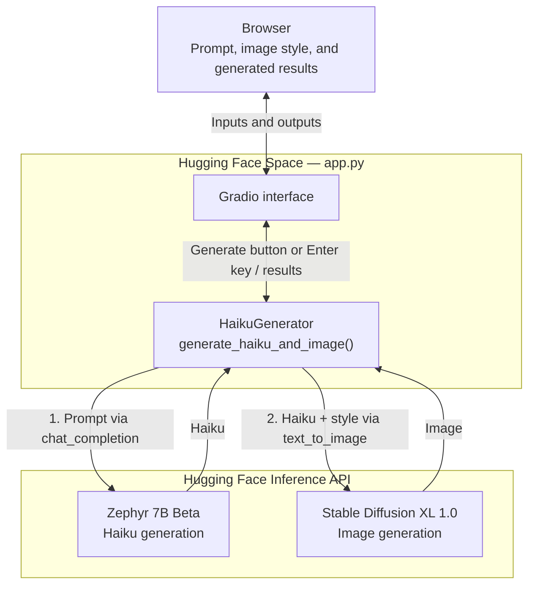

# HaiKool
A Gradio-based GenAI web app that I made for generating Haiku poems based on user prompt/specs using a fine-tuned version of the Mistral 7B model. The poem is fed to Stable Diffusion, which creates an image based on user preference. Models are called via Hugging Face API. The application can be publicly found on Hugging Face Spaces: https://huggingface.co/spaces/huathedev/haikool-haiku-poem-image-generator

## Architecture

The Gradio app runs on Hugging Face Spaces and uses `huggingface_hub.InferenceClient` to call the text and image models. Generation is sequential: the haiku becomes the image prompt, with an optional art-style suffix.

| Stage | Model |
| --- | --- |
| Haiku generation | `HuggingFaceH4/zephyr-7b-beta` |
| Image generation | `stabilityai/stable-diffusion-xl-base-1.0` |

The `generate_haiku_and_image()` callback coordinates both steps and returns the poem and image together after image generation completes. The default style uses the haiku unchanged; Japanese and oil-painting styles append a description to the image prompt. Both API clients authenticate with the server-side `HUGGINGFACE_API_TOKEN` environment variable, which is not sent to the browser.
